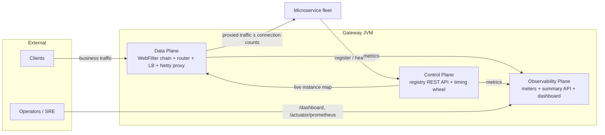
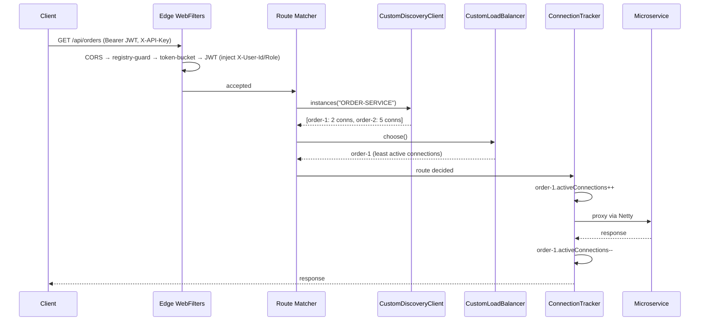

# 📐 System Design — Hyper-Reactive API Gateway

> **How to read this document.** §1–§2 are the High-Level Design (boxes, arrows, planes) for readers in a hurry. §3–§9 are the Low-Level Design (classes, fields, threads, ordering, failure modes) for builders and the deeply curious.

---

## 1. Context Diagram



**Design axiom:** *zero external infrastructure.* All state is in-process memory; all coordination happens over plain HTTP. This is a deliberate tradeoff (§10).

---

## 2. High-Level Design: The Three Planes

| Plane | Components | Lifecycle |
|---|---|---|
| **Control** | `RegistryController` → `RegisterService` → `InstanceEviction` (timing wheel) | Runs continuously; 1 tick/sec |
| **Data** | `CorsWebFilter` → `RegistryProtectionFilter` → `RateLimitingFilter` → `JwtAuthenticationFilter` → `AcceptedRequestsFilter` → route matcher → `CustomDiscoveryClient` → `CustomLoadBalancer` → `ConnectionTrackerFilter` → `NettyRoutingFilter` | Per request |
| **Observability** | `GatewayMetrics`, `ObservabilityController`, `/actuator/prometheus`, embedded React dashboard | Poll/scrape driven |

Key property: the data plane is **fully reactive** — Netty event-loop threads never block; every filter returns a `Mono` and releases the thread during I/O.

---

## 3. LLD: Data Plane — Request Lifecycle & Filter Ordering



### Filter ordering contract

| Order | Component | Kind | Duty | Rejects with |
|---|---|---|---|---|
| `HIGHEST` | `CorsWebFilter` | WebFilter | Preflight & CORS headers | — |
| `-100` | `ObservabilityFilter` | WebFilter | Count received | — |
| `-2` | `RegistryProtectionFilter` | WebFilter | `X-Registry-Token` on `/registry/**` | `403` |
| `-1` | `RateLimitingFilter` | WebFilter | Token bucket per API key | `429` |
| `0` | `JwtAuthenticationFilter` | WebFilter | JWT verify + header injection | `401` |
| `1` | `AcceptedRequestsFilter` | WebFilter | Count accepted | — |
| *(mapping)* | `RoutePredicateHandlerMapping` | — | Route selection | `404` |
| `10150` | `ReactiveLoadBalancerClientFilter` | Gateway filter | Instance choice | `503` |
| `10151` | `ConnectionTrackerFilter` | Global filter | ±1 active connections | — |
| `MAX` | `NettyRoutingFilter` | Gateway filter | Actual proxying | `5xx` |

**Why WebFilters for guards?** `GlobalFilter`s only execute on *matched routes*; `@RestController` endpoints (like `/registry/**`) silently bypass them. Edge security must therefore sit below routing, in the `WebFilter` chain.

---

## 4. LLD: Control Plane — Registry & Self-Healing

### 4.1 Core data structure

```
serviceFinder : ConcurrentHashMap< serviceName,
                  ConcurrentHashMap< instanceID, ServiceInstance > >
```

`ServiceInstance` fields:

| Field | Type | Concurrency note |
|---|---|---|
| `serviceName`, `instanceID`, `host`, `port`, `weight` | immutable-after-register | safe |
| `activeConnections` | `AtomicInteger` | lock-free ±1 from tracker |
| `lastHeartBeatTime` | `Instant` | written only by registry thread paths |
| `timeoutReference` | `volatile TimeoutTask` | swapped on every heartbeat |

### 4.2 Registration & heartbeat sequence

```mermaid
sequenceDiagram
    participant S as Microservice (SDK)
    participant RC as RegistryController
    participant RS as RegisterService
    participant TW as Timing Wheel

    S->>RC: POST /registry/register (+ X-Registry-Token)
    RC->>RS: register(instance)
    RS->>RS: stamp heartbeat; computeIfAbsent(service); put(instance)
    RS->>TW: scheduleTimeout(instance, 90s)
    loop every 30s while alive
        S->>RC: POST /registry/heartbeat
        RC->>RS: renewHeartbeat(service, instance)
        RS->>RS: update lastHeartBeatTime
        RS->>TW: old task.isCancelled = true; schedule new 90s task
    end
```

### 4.3 The hierarchical timing wheel (O(1) eviction)

```
        tick 1×/sec ──────────────────────────────▶
        ┌────┬────┬────┬─────┬────┬────┐
 carts: │ 0  │ 1  │ 2  │ …   │ 58 │ 59 │     60 carts × 1 second
        └────┴────┴────┴─────┴────┴────┘
              ▲ currentTick
              │ each tick, for every task in current cart:
              │    task.isCancelled ?  drop
              │    task.rounds > 0  ?  rounds--
              │    else             →  registerService.deleteInstance(service, instance)
        
        schedule(delaySec):  cart   = (currentTick + delaySec) % 60
                             rounds =  delaySec / 60          // 90s → +30 carts, 1 round
```

**Why O(1):** scheduling is a queue append; each tick inspects only *one* cart. Eviction cost is independent of fleet size — 10 instances or 60,000.

**Eviction flow:** wheel expires task → `deleteInstance(serviceName, instanceID)` → remove from inner map → cancel stale task → drop the service key if its inner map became empty. Graceful shutdown uses the *same* method via `DELETE /registry/deregister`.

**Tuning invariant:** heartbeat interval (30s) ≪ eviction deadline (90s) → tolerates 2 missed beats.

---

## 5. LLD: Discovery Bridge & Load Balancing Feedback Loop

- `CustomDiscoveryClient implements ReactiveDiscoveryClient`
  - `getServices()` → `serviceFinder.keySet()`
  - `getInstances(name)` → maps each `ServiceInstance` to a Spring `DefaultServiceInstance`, copying `weight` and `activeConnections` into **metadata**.
- `CustomLoadBalancer implements ReactorServiceInstanceLoadBalancer`
  - `choose()` → supplier list → `activeLeastConnection()` → min of metadata `activeConnections`.
- `ConnectionTrackerFilter` (order 10151) closes the loop: reads the chosen instance from `GATEWAY_LOADBALANCER_RESPONSE_ATTR`, increments before proxying, decrements in `.then(...)`.

```
   ConnectionTrackerFilter ──(+1 / −1)──▶ ServiceInstance.activeConnections
                ▲                                       │
                │                                       ▼
   CustomLoadBalancer ◀── metadata snapshot ── CustomDiscoveryClient ◀── registry
     (picks minimum)                              (per choose() call)
```

The metadata is a *snapshot*; the tracker keeps the *truth* live. Together they make least-connections routing **telemetry-driven, not guess-driven**.

---

## 6. LLD: Rate Limiting (Token Bucket)

```
request ─▶ key = X-API-Key header (fallback: client IP)
        ─▶ bucket = registry.computeIfAbsent(key)
        ─▶ bucket.tryConsume()  ──yes──▶ chain.filter(...)
                                 └─no───▶ 429 + X-RateLimit-* + Retry-After
```

`TokenBucket` internals (per-user instance):

| Field | Meaning |
|---|---|
| `maxTokens` | burst capacity (default 60) |
| `availableTokens` | current balance (double) |
| `refillRatePerNano` | constant rate (default 1 token/sec) |
| `lastRefillTimestamp` | last computation point |

`tryConsume()` is `synchronized` **on the bucket object** — contention exists only between concurrent requests of the *same* user; different users lock different objects. Refill is computed lazily: `available = min(max, available + elapsed × rate)` — no background threads per user.

**Memory hygiene:** `TokenBucketRegistry` runs a `@Scheduled(60s)` sweep deleting buckets idle > 5 minutes.

**Placement rationale:** order `-1`, i.e. *before* routing/LB — a rejected request must cost nearly zero CPU.

---

## 7. LLD: Security — The Trust Boundary

```
client ──Bearer JWT──▶ JwtAuthenticationFilter
                        │ public path? ──yes──▶ pass
                        │ missing/invalid ──▶ 401 JSON
                        │ valid:
                        │   1. REMOVE incoming X-User-Id / X-User-Role   (anti-spoofing)
                        │   2. SET   X-User-Id = sub, X-User-Role = role
                        ▼
                     downstream service  →  trusts headers, ships no security code
```

- **Registry guard:** `X-Registry-Token` compared with `MessageDigest.isEqual` (constant-time); blank configured token ⇒ deny-all (secure by default).
- **JWT:** HS256 via jjwt; signature + expiry verified; public paths matched with `AntPathMatcher`.
- **Dev ergonomics:** `/auth/dev-token` exists only under `@Profile("dev")`.

---

## 8. LLD: Observability Plane

| Meter | Type | Written by |
|---|---|---|
| `gateway_requests_received_total` | Counter | `ObservabilityFilter` (-100) |
| `gateway_requests_accepted_total` | Counter | `AcceptedRequestsFilter` (1) |
| `gateway_requests_blocked_total{reason}` | Counter | guards (`rate_limited`, `unauthorized`, `registry_forbidden`) |
| `gateway_connections_active{service,instance}` | MultiGauge | 5s refresh from registry |
| `gateway_registry_instances{service}` | MultiGauge | 5s refresh from registry |

**Why `MultiGauge`:** the row-set (instances) appears and disappears dynamically; `register(rows, true)` atomically replaces stale rows so evicted instances vanish from metrics automatically.

**Consumers:**
- `/gateway/observability/summary` → JSON (totals, blocked-by-reason, per-service breakdown, **busiest instance**) → polled every 3s by the embedded React dashboard.
- `/actuator/prometheus` → Prometheus scrape → Grafana for history/alerts.

**Dashboard build pipeline:** `dashboard/` (Vite + React + TS) → `vite build` outputs into `src/main/resources/static/dashboard` → `frontend-maven-plugin` runs this inside `mvn package` → single JAR serves UI at `/dashboard/` via a `RouterFunction`.

---

## 9. Concurrency & Threading Model

- **Netty event loops** execute all filters; nothing blocks (no JDBC, no locks held across I/O).
- **Locks that exist:** per-bucket `synchronized` in `TokenBucket` (nanosecond-scale arithmetic only).
- **Shared mutable state:** `ConcurrentHashMap` (registry, buckets), `AtomicInteger` (connections), `volatile` (timeout references), `MultiGauge` refresh on a scheduler thread.
- **Schedulers:** `@Scheduled` tasks (wheel tick 1s, bucket sweep 60s, gauge refresh 5s) run on Spring's task scheduler, never on event loops.

---

## 10. Tradeoffs & Failure Modes

| Failure / scenario | System behavior |
|---|---|
| Service crashes silently | Evicted ≤ 90s + 1 tick by the wheel |
| Service shuts down gracefully | `DELETE /registry/deregister` removes it instantly |
| Client spams | 429 after bucket drains; other keys unaffected |
| Forged identity headers | Stripped before trusted values are injected |
| Stranger registers a service | 403 (constant-time token compare) |
| Gateway restarts | Registry empty; SDK heartbeats repopulate within 30s |
| One downstream slows | Its `activeConnections` rises → LB shifts new traffic away |
| **Multiple gateway replicas** | ⚠️ State is per-JVM: buckets & registry diverge → graduate to Redis/Consul (see README tradeoff table) |

---

## 11. Extension Guide (where new features plug in)

| You want to add… | Plug into… |
|---|---|
| A new edge guard (e.g., IP blocklist) | New `WebFilter` with `@Order` between `-2` and `0` |
| A new metric | `GatewayMetrics` + increment at the right filter order |
| Per-route behavior (retries, timeouts) | `GatewayFilter`/`GlobalFilter` with order `> 10150` |
| A new routing source | Another `ReactiveDiscoveryClient` bean or `RouteLocator` |
| Persistent registry | Snapshot `serviceFinder` on deregister/evict; reload at boot |

---

*Design decisions, bugs encountered and fixes are narrated in the [Medium build log](https://medium.com/@your-handle). Code is the source of truth; this document is the map.*